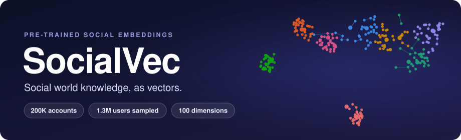
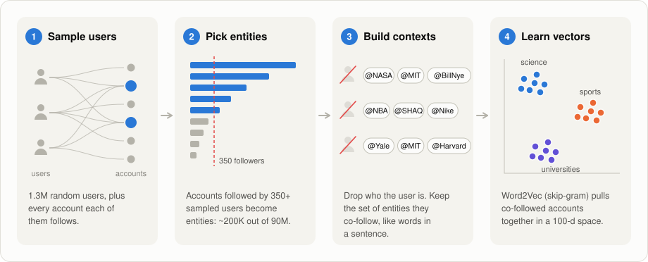
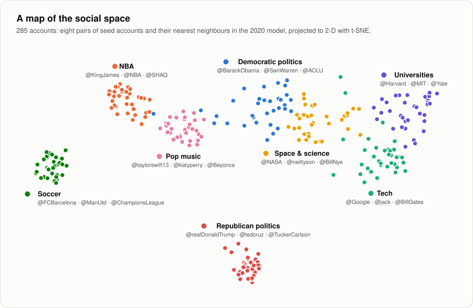
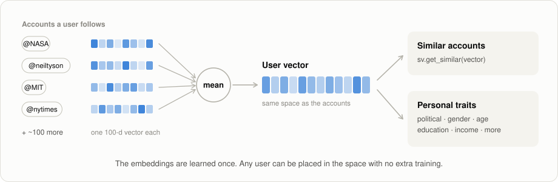
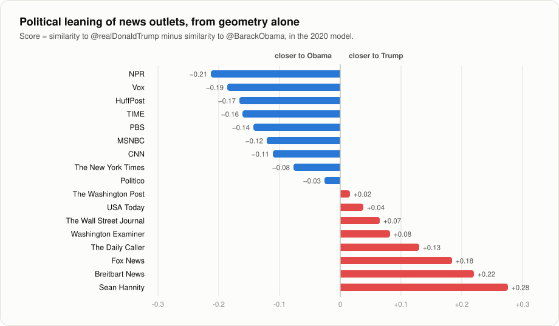
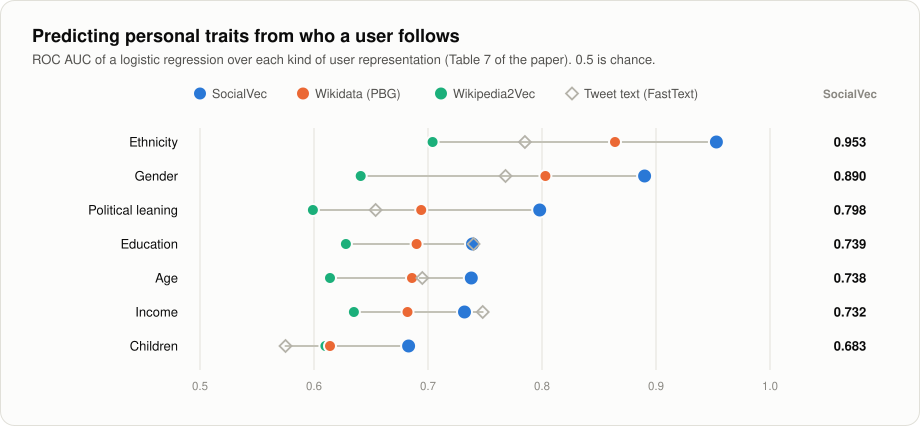

<p align="center">
  
</p>

<p align="center">
  <a href="https://pypi.org/project/socialvec/"></a>
  <a href="https://pypi.org/project/socialvec/"></a>
  <a href="https://github.com/nirlotan/SocialVec/actions/workflows/tests.yml"></a>
  <a href="https://github.com/nirlotan/SocialVec/blob/master/LICENSE"></a>
  <a href="https://doi.org/10.1371/journal.pone.0283700"></a>
</p>

<p align="center">
  <a href="#quick-start">Quick start</a> ·
  <a href="#how-it-works">How it works</a> ·
  <a href="#what-the-embeddings-know">What the embeddings know</a> ·
  <a href="#used-in-research">Used in research</a> ·
  <a href="#usage">Usage</a> ·
  <a href="#citation">Citation</a>
</p>

# SocialVec

**SocialVec** provides pre-trained *social embeddings* for about 200,000 popular Twitter accounts, learned from the follow lists of 1.3 million users. Accounts that are often followed by the same people end up close together, the same way words that appear in similar contexts do in word embeddings.

The result captures *social world knowledge*: how people relate to entities, rather than facts about them. It was developed by Nir Lotan and Einat Minkov at the University of Haifa, and is described in [Social world knowledge: Modeling and applications](https://journals.plos.org/plosone/article?id=10.1371/journal.pone.0283700) (PLOS ONE, 2023). It has since been used in [several other studies](#used-in-research).

With this package you can:

- get the 100-dimensional embedding of a popular account, by user ID or username;
- find similar accounts, for one account, a group of accounts, or any vector;
- represent any user as the average embedding of the accounts they follow;
- predict personal traits (political leaning, gender, age, and more) from an embedding;
- serve all of the above over a small HTTP API, or use it from the command line.

## Why social embeddings?

Knowledge bases such as Wikipedia and Wikidata describe facts. They know that Hillary Clinton and Donald Trump both ran for president in 2016. They do not know that the two have very different audiences, that Princeton is perceived as a peer of Yale rather than of the town it sits in, or that Star Trek fans follow its actors.

SocialVec learns that kind of knowledge from behaviour. These are the nearest neighbours of three entities in SocialVec and in [Wikipedia2Vec](https://wikipedia2vec.github.io/wikipedia2vec/), an embedding learned from Wikipedia (Table 2 of the paper):

| Query | SocialVec | Wikipedia2Vec |
|---|---|---|
| **Hillary Clinton** | Elizabeth Warren, Michelle Obama, Planned Parenthood, Jim Acosta, Cory Booker | 2016 U.S. presidential election, Barack Obama, Joe Biden, Donald Trump, John Kerry |
| **Princeton University** | Columbia, Yale, Cornell, Brown, Cambridge | Princeton School of Public and International Affairs, Institute for Advanced Study, List of Princeton University people, Princeton (New Jersey), Nassau Hall |
| **Star Trek** | Jeri Ryan, Gates McFadden, Michael Dorn, Jonathan Frakes, Dan Aykroyd | The Original Series, The Next Generation, Deep Space Nine, Voyager, James T. Kirk |

## Quick start

```bash
pip install socialvec
```

```python
from socialvec.socialvec import SocialVec

sv = SocialVec()                    # downloads the model on first use, see "Models and data"
sv.get_similar("jack", topn=5)
```

```
  twitter_id  similarity   screen_name           name  description
0    6385432    0.841613         dickc   dick costolo  ...
1        989    0.831723            om             OM  ...
2    5746452    0.827466  waltmossberg  Walt Mossberg  ...
3   20536157    0.826462        Google         Google  ...
4    6708952    0.819312     SteveCase     Steve Case  ...
```

## How it works

SocialVec applies the idea behind Word2Vec to a social network. Word2Vec learns what a word means from the words that appear around it. SocialVec learns what an account means, socially, from the other accounts that the same people follow.

<p align="center">
  
</p>

1. **Sample users.** 1.3 million U.S. Twitter users were sampled at random, and the full list of accounts each one follows was collected in early 2020: 1.2 billion follow relationships that point at 90 million distinct accounts.
2. **Pick entities.** Most accounts are followed only by a small social circle. The accounts followed by at least 350 of the sampled users are kept as *entities* of general interest. That leaves 201,247 accounts: politicians, artists, athletes, companies, news outlets, universities and more.
3. **Build contexts.** The entities that one user follows form a coherent social context, because they reflect that person's interests, tastes and background. Each follow list becomes one training example. The user's identity is discarded, and so is every account that is not an entity.
4. **Learn vectors.** A skip-gram model with negative sampling is trained to predict, for every entity a user follows, the other entities that the same user follows. Entities that share an audience are pulled together in a 100-dimensional space.

The analogy with word embeddings is direct:

| Word2Vec | SocialVec |
|---|---|
| a word | a popular account (an entity) |
| a sentence | the set of entities one user follows |
| words that appear in the same contexts have similar meaning | accounts that are followed by the same people are socially similar |
| a sliding window of a few words | the whole follow list, which has no order |

Two properties follow from this design. It is **efficient**: it needs a sample of users, not the whole network, and it models 200K entities instead of 90 million accounts. It is **private by construction**: only entity co-occurrences are used, so the embeddings describe global social patterns and contain no trace of the individual users that were sampled.

<details>
<summary><b>Training details</b></summary>

| | |
|---|---|
| Users sampled | 1.3 million (U.S., English-language) |
| Follow relationships | 1,236 million |
| Distinct accounts followed | 90.4 million |
| Entities (followed by ≥ 350 sampled users) | 201,247 |
| Entities followed per user | 228 on average, median 108 |
| Entities with a Wikipedia or Wikidata entry | 15.8% |
| Model | Word2Vec skip-gram with negative sampling ([gensim](https://radimrehurek.com/gensim/)) |
| Context | all the entities a user follows (window of 1,000) |
| Negative samples | 20 |
| Embedding size | 100 |

The training code and the list of sampled user IDs are in [SocialVecTraining](https://github.com/nirlotan/SocialVecTraining).

</details>

### A map of the social space

The figure below is not a sketch. It takes eight pairs of well-known accounts, adds the nearest neighbours of each pair in the `2020` model, and projects the 285 resulting vectors to two dimensions. Communities form distinct groups, and related ones sit side by side: science next to universities and tech, the NBA next to pop music.

<p align="center">
  
</p>

### From accounts to people

Most users are not popular enough to have an embedding of their own. Any user can still be placed in the same space, as the average of the embeddings of the accounts they follow. That vector can be compared with any account, or passed to a classifier.

<p align="center">
  
</p>

## What the embeddings know

The paper evaluates SocialVec on two tasks. In both, it is compared with entity embeddings learned from factual sources: Wikipedia2Vec, and Wikidata graph embeddings trained with PyTorch-BigGraph (PBG).

### The political leaning of news outlets

Take two anchor accounts, one for each side of U.S. politics. The political orientation of any other account is the difference between its similarity to each anchor. No labels and no training are needed:

```python
def political_orientation(account):
    return sv.get_similarity("realDonaldTrump", account) - sv.get_similarity("BarackObama", account)

political_orientation("NPR")        # -0.21
political_orientation("FoxNews")    #  0.18
```

<p align="center">
  
</p>

The scores in the figure were computed with the code above and the default `2020` model. In the paper, the ranking of outlets produced this way was compared with the audience surveys of Pew Research:

| | SocialVec | Wikipedia2Vec | Wikidata (PBG) |
|---|---|---|---|
| Rank correlation with the Pew 2014 poll (Spearman) | **0.82** | 0.36 | -0.40 |
| Rank correlation with the Pew 2020 poll (Spearman) | **0.85** | 0.28 | -0.32 |
| Outlets on the correct side, Pew 2014 | **94%** | 55% | 32% |
| Outlets on the correct side, Pew 2020 | **97%** | 60% | 27% |

### The personal traits of users

Users from a labelled dataset were represented by the average embedding of the accounts they follow, and a logistic regression was trained for each trait. SocialVec was the most informative entity embedding on all seven traits. It also did better than a classifier that reads the user's tweets on five of them; the two were tied on education, and the tweets were better on income.

<p align="center">
  
</p>

The classifiers that ship with this package are described [below](#classifiers).

## Used in research

SocialVec has been used as a source of social knowledge in peer-reviewed papers, preprints and a graduate thesis:

| Year | Work | Venue |
|---|---|---|
| 2023 | [**Social world knowledge: Modeling and applications**](https://doi.org/10.1371/journal.pone.0283700)<br>N. Lotan, E. Minkov<br><sub>Introduces SocialVec.</sub> | PLOS ONE |
| 2023 | [**Detecting Multidimensional Political Incivility on Social Media**](https://arxiv.org/abs/2305.14964)<br>S. Pendzel, N. Lotan, A. Zoizner, E. Minkov<br><sub>Separates impoliteness from political intolerance, and shows that information about a tweet's author improves detection.</sub> | arXiv |
| 2024 | [**A Closer Look at Multidimensional Online Political Incivility**](https://aclanthology.org/2024.emnlp-main.827/)<br>S. Pendzel, N. Lotan, A. Zoizner, E. Minkov<br><sub>A 13K-tweet benchmark of impolite and intolerant political speech, and a large-scale look at who is uncivil.</sub> | EMNLP 2024 |
| 2024 | [**The X Types: Mapping the Semantics of the Twitter Sphere**](https://arxiv.org/abs/2409.14584)<br>O. Schlachet Drukerman, E. Minkov<br><sub>Labels about 200K popular accounts with 136 fine-grained semantic types, combining content with network embeddings.</sub> | arXiv |
| 2024 | [**Social Profiling for Stance Detection**](https://www.proquest.com/openview/fba537ad5ef6c64685862f2ecd1d3694/1?pq-origsite=gscholar&cbl=2026366&diss=y)<br>I. Cohen | Thesis, University of Haifa |
| 2025 | [**Towards Author-informed NLP: Mind the Social Bias**](https://aclanthology.org/2025.emnlp-main.1764/)<br>I. Pendzel, E. Minkov<br><sub>Represents authors in a social embedding space to improve stance, toxicity and incivility detection, and examines the social biases this can reinforce.</sub> | EMNLP 2025 |
| 2026 | [**Social Knowledge for Cross-Domain User Preference Modeling**](https://arxiv.org/abs/2603.10148)<br>N. Lotan, A. Solomon, I. Guy, E. Minkov<br><sub>Places users and popular entities in one social embedding space and predicts preferences across domains, zero-shot.</sub> | arXiv |
| 2026 | [**Who Goes Toxic? Understanding Political Toxicity on Social Media Across Individuals and Contexts**](https://doi.org/10.1177/08944393261506316)<br>A. Zoizner, N. Lotan, S. Pendzel, E. Minkov<br><sub>Studies about 185K U.S. users and 25M tweets to find who posts toxic political content, and in which contexts.</sub> | Social Science Computer Review |

Have you used SocialVec in your work? Open an [issue](https://github.com/nirlotan/SocialVec/issues) or a pull request to add it to this list.

## Installation

```bash
pip install socialvec
```

The classifiers need TensorFlow and the HTTP API needs Flask. Both are optional extras:

```bash
pip install "socialvec[classifier]"        # adds TensorFlow
pip install "socialvec[api]"               # adds Flask and flask-cors
pip install "socialvec[classifier,api]"    # both
```

SocialVec supports Python 3.10 to 3.13.

## Usage

### Embeddings

An account can be given as a user ID (an `int`, including numpy integers, or a string of digits) or as a username (case-insensitive):

```python
sv[12]                    # the same 100-dimensional vector, three ways
sv["12"]
sv["jack"]

sv.get_userid("NASA")       # '11348282'
sv.get_screen_name(813286)  # 'BarackObama'
```

### Similar accounts

`get_similar` takes a user ID, a username, a vector, or a list of IDs and usernames (whose embeddings are averaged). It returns a pandas DataFrame with the `topn` most similar accounts and their metadata.

```python
sv.get_similar(["Harvard", "MIT", "UCLA"], topn=5)
```

```
  twitter_id  similarity      screen_name                  name
0    5695032    0.867065             Yale       Yale University
1    5694822    0.861724        Princeton  Princeton University
2  248795646    0.850461         Columbia   Columbia University
3   14884486    0.845595  BrownUniversity      Brown University
4   33474655    0.840983    Cambridge_Uni  Cambridge University
```

```python
sv.get_similar(["FCBarcelona", "ManUtd", "realmadrid"], topn=5)
```

```
  twitter_id  similarity     screen_name              name
0  740336334    0.931517    GarethBale11       Gareth Bale
1  344801362    0.917337     DavidLuiz_4        David Luiz
2  140750163    0.915364       juanmata8  Juan Mata García
3  112764971    0.913976  FCBarcelona_es      FC Barcelona
4  533085085    0.912526             M10        Mesut Özil
```

### Similarity between two accounts

```python
sv.get_similarity("BarackObama", "HillaryClinton")    # 0.755
sv.get_similarity("BarackObama", "realDonaldTrump")   # 0.613
```

Either argument can also be a vector.

### Embedding any user

Most users aren't popular enough to have their own embedding. You can represent them by the average embedding of the accounts they follow. `get_average_embeddings` takes a list of user IDs and returns the average vector and the number of accounts it was based on. IDs that aren't in the model are skipped; if none are left, the vector is all zeros and the count is 0.

```python
following = [12, 989, 783214]           # e.g. the IDs a user follows, from the Twitter/X API
vector, count = sv.get_average_embeddings(following)
sv.get_similar(vector, topn=5)
```

### Classifiers

The classifiers predict personal traits from an embedding. They need the `classifier` extra (TensorFlow) and the `"2020c"` model they were trained on; calling `init_classifier()` on another model raises an error.

```python
sv = SocialVec(model_name="2020c")
sv.init_classifier()

sv.classifier.predict("political", sv["JoeBiden"])          # ('Democrat', 0.989)
sv.classifier.predict("political", sv["realDonaldTrump"])   # ('Republican', 0.866)
```

`predict` returns the predicted class and a confidence between 0 and 1, where 1 is high confidence and 0 is no confidence (which may be expected for accounts with no affiliation, e.g. a non-political account and the `political` classifier). To classify an ordinary user, pass the vector from `get_average_embeddings`.

| Classifier | Classes |
|---|---|
| `political` | Republican / Democrat |
| `gender` | Male / Female |
| `children` | Yes / No |
| `age` | Under25 / Over25 |
| `education` | Degree / HighSchool |
| `income` | High / Low |
| `ethnicity` | Caucasian / AfrAmerican |

`sv.classifier.classifier_names` lists them.

### Errors

Lookups raise `socialvec.exceptions.InvalidUserIdError` (a `ValueError`) for values that aren't a user ID or username, and `socialvec.exceptions.UserNotFoundError` (a `KeyError`) for accounts that aren't in the loaded model. An unknown `model_name` raises `UnknownModelError` (a `ValueError`), and a failed download raises `SocialVecError`. All of them subclass `socialvec.exceptions.SocialVecError`.

## Models and data

| `model_name` | Notes |
|---|---|
| `"2020"` | Default. |
| `"2020c"` | The model the classifiers were trained on. |
| `"2020_2022"` | |

On first use, SocialVec downloads the model (about 150 MB, or 300 MB for `"2020_2022"`) and the account metadata (about 30 MB). Later runs load them from disk.

- Files are kept in `~/.cache/socialvec`. To keep them somewhere else, set the `SOCIALVEC_HOME` environment variable to a folder.
- Files that versions up to 0.1.7.1 saved in the package folder or the working folder are still found and used.
- Every file is checked against a SHA-256 checksum before it is loaded.
- If the cache folder can't be written, the model is loaded into memory instead (and downloaded again next time).

## Command line

```bash
socialvec similar jack --topn 5
socialvec similarity BarackObama HillaryClinton
socialvec predict political JoeBiden          # uses the 2020c model; needs the classifier extra
socialvec download --model 2020c              # fetch a model ahead of time
```

`socialvec --help` lists all options. Every command takes `--model` to choose the model.

## HTTP API

SocialVec includes a small Flask API (install the `api` extra):

```bash
SOCIALVEC_MODEL=2020c python -m socialvec.api
```

It can also run under a WSGI server, e.g. `gunicorn "socialvec.api:create_app()"`. Importing `socialvec.api` does not load a model; `create_app()` does.

| Variable | Default | Meaning |
|---|---|---|
| `SOCIALVEC_MODEL` | `2020` | Model to load. `/predict` and `/predict_proba` need `2020c`; with other models they return 501. |
| `SOCIALVEC_CORS_ORIGINS` | `*` | Comma-separated origins allowed to call the API from a browser. |
| `SOCIALVEC_HOST` | `127.0.0.1` | Address to listen on. Use `0.0.0.0` to accept connections from other machines. |
| `PORT` | `8000` | Port to listen on. |

Endpoints:

- `GET /validate_userid?userid=`, `/validate_username?username=`, `/get_screen_name?userid=`, `/get_userid?username=`
- `GET /get_similar?input=&topn=` (`topn` is clamped to 1–100), `/get_embeddings?entity=`, `/get_similarity?entity1=&entity2=`
- `POST` with a JSON body: `/get_average_embeddings` `{"entity_list": [...]}`, `/predict` and `/predict_proba` `{"classifier_name": "political", "entity": "jack"}`

Errors are returned as `{"error": "..."}` with status 400 for bad input, 404 for accounts not in the model, and 500 (with no details) for unexpected errors, which are logged.

## Limitations and responsible use

- **The embeddings reflect Twitter.** Its users are younger and lean more Democratic than the general public, the sample is of U.S. users who tweet in English, and some kinds of entities (places, for example) are poorly represented there.
- **They are a snapshot.** The follow data was collected in early 2020. Accounts that became popular later are missing, and some accounts in the model have since been renamed, suspended or deleted.
- **Rare accounts are noisier.** An account that few of the sampled users followed has less context behind its vector.
- **Trait predictions are statistical.** They describe patterns across many users and can be wrong, or stereotypical, for any one person. Use them for aggregate research and analysis, and tell people when you personalise something for them.

The embeddings were built from public follow information, with the identities of the sampled users discarded. They were released to support research on social world knowledge.

## Citation

If you use SocialVec in your research, please cite:

```bibtex
@article{lotan2023social,
  title   = {Social world knowledge: Modeling and applications},
  author  = {Lotan, Nir and Minkov, Einat},
  journal = {PLOS ONE},
  volume  = {18},
  number  = {7},
  pages   = {e0283700},
  year    = {2023},
  doi     = {10.1371/journal.pone.0283700}
}
```

## License

MIT. See [LICENSE](https://github.com/nirlotan/SocialVec/blob/master/LICENSE). The changelog is in [HISTORY.rst](https://github.com/nirlotan/SocialVec/blob/master/HISTORY.rst).
